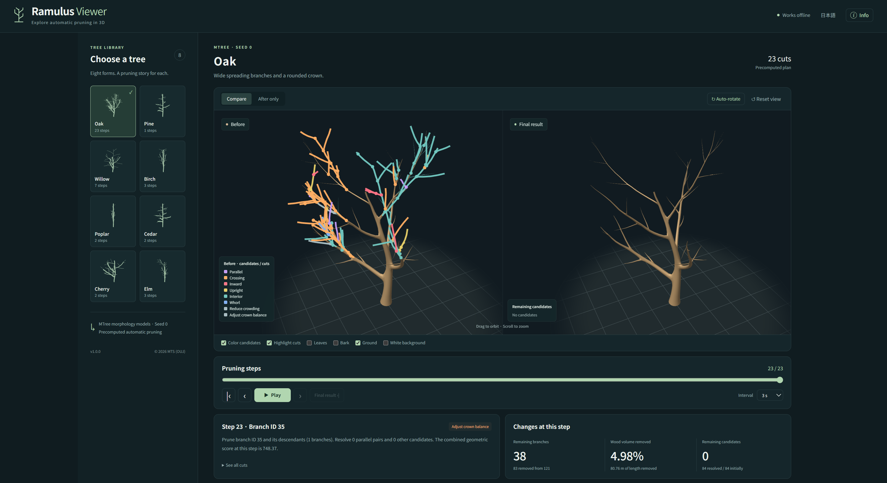
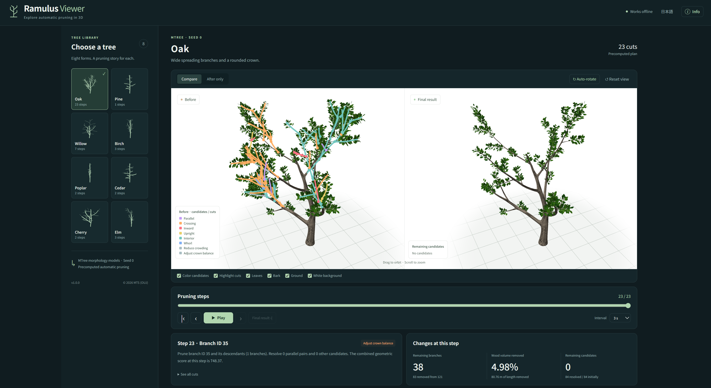
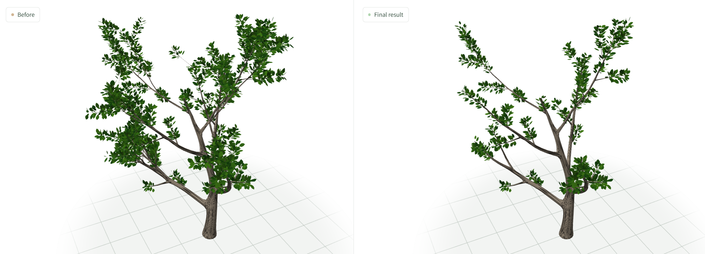

# Ramulus Viewer

**Explore automatic pruning in 3D.**

Ramulus Viewer visualizes precomputed pruning plans for different tree morphologies. It lets you inspect pruning candidates, step through individual cuts, and compare the tree before and after pruning in a 3D viewer.

## Screenshots

### 1. Pruning candidates and cut categories

Color-coded branches show pruning candidates and cut categories. The side-by-side view compares the original tree with the final pruning result.

### 2. Pruning comparison with leaves and bark

Enable leaves, bark, ground, and a white background to inspect how pruning changes the tree's appearance.

### 3. Before and after pruning

A close-up comparison highlights the changes to the tree's crown and branch structure.

## Features

- Eight tree models: Oak, Pine, Willow, Birch, Poplar, Cedar, Cherry, and Elm.
- Interactive 3D comparison of the original and pruned trees.
- Step-by-step playback of a precomputed pruning plan.
- Color-coded pruning candidates and cut categories.
- Display options for leaves, bark, ground, and background color.
- Per-step statistics, including remaining branches, removed wood volume, and remaining candidates.

---

© 2026 MTS
